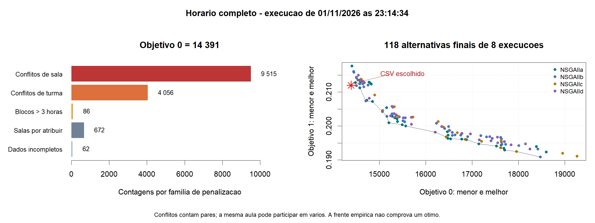

# Análise do horário completo e da abordagem de otimização

Execução analisada: **20261101-231434-879**, de 01/11/2026 às 23:14:34. Data da análise: 01/11/2026. Este relatório descreve a implementação e os resultados existentes; não constitui uma nova execução ou alteração do algoritmo.

## 1. Conclusão sobre a qualidade

O resultado ainda **não é um horário utilizável**. É um candidato completo, com 26 019 ocorrências preservadas, que confirma a execução da pipeline nativa com todos os dados. Persistem muitos conflitos de recursos e de turmas e pendências que o algoritmo não pode resolver por si.

A versão analisada é a mais recente indicada em RESULTADOS.txt. O HORARIO.csv corresponde à cópia nativa desta execução nos campos Data, Inicio, Fim, Sala, Turma, Inscritos e hard_violations; foi verificada a igualdade de todos os 26 019 registos nesses campos. O HORARIO-COMPLETO.csv da execução anterior tem outro resultado: não deve ser confundido com o CSV atual.

| Componente do objetivo 0 | Valor |
|---|---:|
| Pares em conflito de sala | 9 515 |
| Pares em conflito de turma | 4 056 |
| Blocos da mesma UC/turma/dia que violam a regra experimental de 3 horas | 86 |
| Salas obrigatórias sem atribuição | 672 |
| Ocorrências com data, turma ou UC em falta | 62 |
| Défice de lugares nas salas efetivamente atribuídas | 0 |
| **Objetivo 0** | **14 391** |

As contagens de conflitos são pares de ocorrências, não números de aulas distintas. A mesma aula pode participar em vários pares e em várias famílias. As 62 ocorrências incompletas incluem 16 sem data e 46 sem turma. As 16 sem data também têm pedido de sala não resolvido, pelo que as categorias não devem ser somadas como se representassem aulas distintas.

Há **15 654 ocorrências distintas, cerca de 60,2% do total**, envolvidas em pelo menos um conflito de sala ou turma, sob a interpretação atual dos grupos.

Exemplo concreto: no dia 12/09/2022, no Auditório B1.04, Marketing Intelligence foi colocado às 09:30–11:00 e Marketing Operacional às 10:00–11:30. Há uma sobreposição de 60 minutos. No dia 06/09/2022, a turma MMFB1 tem Econometria dos Mercados Financeiros às 10:00–12:00 e Métodos Numéricos às 10:30–12:30. A sala de cada aula pode ser localmente adequada e, ainda assim, o horário ser globalmente incompatível.

O estado ASSIGNED_CHECK_GLOBAL_CONFLICTS apenas indica que não foi registada uma das pendências locais no campo Estado. Não significa que a aula esteja livre de conflitos globais.

## 2. O que ficou corretamente preservado

Foram confirmados os 26 019 identificadores de origem, sem omissões. As salas efetivamente atribuídas respeitam o cadastro original, o requisito de característica e a capacidade normal suficiente. Para as ocorrências com data, preservam-se semana e duração originais, usando a grelha de 30 minutos e o período experimental de funcionamento.

Das 24 764 ocorrências que necessitam de sala física, 24 092 têm sala atribuída: cerca de 97,29%. As restantes 672 continuam pendentes. As 1 255 atividades que não necessitam de sala não devem ser interpretadas como falhas de atribuição.

Os 672 casos sem sala elegível decompõem-se em:

- 371 sem capacidade suficiente no cadastro para o requisito identificado.
- 301 pedidos não resolvidos: 285 Lab ISTA e 16 pedidos em branco.

Compatibilidade individual não implica disponibilidade conjunta. Os 24 092 domínios não vazios permitem escolher salas adequadas para cada aula isoladamente; os conflitos mostram que ainda falta coordenar essas escolhas.

## 3. Comparação com o horário histórico

Foi usado o horário original como referência prática, recalculando as métricas temporais com a mesma interpretação dos identificadores e da regra de sequências.

| Indicador temporal | Histórico | Gerado |
|---|---:|---:|
| Pares em conflito de turma | 931 | 4 056 |
| Janelas agregadas por turma/dia, em minutos | 177 780 | 2 983 650 |
| Blocos que violam a regra experimental das 3 horas | 1 104 | 86 |

Para conflitos de sala, num subconjunto comparável de **23 115 ocorrências que têm sala em ambos os horários**, foram encontrados **0 pares no histórico e 8 853 no gerado**. No conjunto total de salas atribuídas do candidato gerado, são os 9 515 pares indicados anteriormente.

O candidato reduziu as violações de sequências, mas piorou os outros indicadores temporais apresentados. A soma das janelas ficou cerca de 16,8 vezes maior. Não há evidência de melhoria global sobre o horário histórico.

No gerado, a média de janela agregada por turma/dia com pelo menos duas ocorrências é cerca de 234 minutos; a mediana é 210 minutos. São medidas por turma/dia, não tempos individuais de espera de cada estudante. A informação de inscrições disponível é uma contagem por turno, não uma lista que permita reconstruir os horários pessoais.

Esta comparação não certifica o histórico como plenamente viável: há divergências entre salas históricas e cadastro, requisitos pendentes e identidade das turmas por rever. Os 931 pares históricos também não demonstram, por si, que houve estudantes concretos em aulas simultâneas. Um mesmo token de turma pode abranger alternativas curriculares; essa hipótese exige revisão semântica, não a remoção automática de conflitos.

## 4. Problematização

Dadas as ocorrências letivas, as turmas textualmente identificadas, os inscritos, as durações, as semanas originais e o cadastro de salas, pretende-se propor atribuições de dia, início e sala que reduzam incompatibilidades e melhorem a organização das aulas.

Os principais interessados são estudantes/turmas, responsáveis pelos horários, cursos e gestão dos espaços. A informação disponível permite avaliar conflitos de salas e turmas e procura de lugares. Não permite avaliar conflitos de docentes ou de estudantes individuais; não são criados dados para essas dimensões.

A unidade de decisão é a ocorrência de aula. Uma aula partilhada por várias turmas mantém-se uma ocorrência. A decisão tem três genes inteiros: índice de dia elegível na semana original, início elegível e sala elegível. O problema completo tem 78 057 genes.

Há duas camadas distintas:

1. Condições impostas nos domínios: semana conhecida, grelha, duração, dias e horas experimentais, requisito de sala aprovado e capacidade normal suficiente.
2. Condições contadas no objetivo 0: conflitos conjuntos, sequências e pendências explícitas.

As pendências não são requisitos resolvidos. A execução diagnóstica permite conservar todas as ocorrências e explorar as partes definidas, mantendo fullyEvaluable=false.

## 5. Funções objetivo atuais

A implementação tem exatamente dois objetivos de minimização e zero entradas em solution.constraints().

### Objetivo 0

f0 = C_sala + C_turma + V_3h + D_lugares + U_sala + I_dados.

C_sala e C_turma contam pares em sobreposição na mesma data. Partilhar várias turmas não duplica o par dentro da família turma; partilhar turma e sala permite contar uma violação em cada família.

V_3h conta blocos da mesma UC, turma e dia com pelo menos duas ocorrências e mais de 180 minutos de ensino. Uma pausa de pelo menos 30 minutos interrompe o bloco. O tratamento de ocorrências individuais longas é uma exceção experimental: existem 180 registos individuais acima de três horas, preservados e assinalados. Não se deve apresentar esta interpretação provisória como regra institucional confirmada.

D_lugares mede o défice positivo de capacidade; é zero nas atribuições produzidas pelos domínios elegíveis. U_sala conta ocorrências que necessitam de sala mas ficam sem atribuição. I_dados conta ocorrências com informação estrutural em falta.

Na configuração atual, **f0 não pode chegar a zero**: U_sala=672 e I_dados=62 são fixos enquanto os dados e a política se mantiverem. O limite inferior diagnóstico é pelo menos 734, mesmo eliminando todos os conflitos e todas as sequências. Isto não prova que os 301 pedidos desconhecidos sejam fisicamente impossíveis; significa que continuam desconhecidos e penalizados. Os 371 domínios sem capacidade suficiente, por outro lado, demonstram incompatibilidade individual sob o cadastro e requisitos estritos.

O resultado 14 391 contém 734 penalizações fixas e 13 657 conflitos/violações de sequências. Aumentar avaliações pode atuar na segunda parcela, mas não corrige informação ausente nem cria salas.

### Objetivo 1

f1 = wp * P/N + wg * G/Bg + ws * S/Bs.

P conta ocorrências fora do período preferido de pelo menos uma turma participante. G soma minutos de janela por turma/dia, sem tempo antes da primeira ou depois da última aula e sem dedução automática de almoço. Sobreposições são tratadas pela união dos intervalos ocupados. S soma lugares excedentes por ocorrência com sala; não é um número de lugares físicos distintos ou uma medida ponderada pela duração.

Neste cenário, wp=0, wg=1 e ws=1. As preferências das 26 019 ocorrências são não avaliadas, não satisfeitas. Faltam perfis configurados para as 529 turmas.

As escalas fixas da instância são:

- Bg = 529 turmas × 287 dias civis × 900 minutos = 136 640 700.
- Bs = soma do maior excedente possível de cada domínio = 4 255 079.

Para o CSV escolhido:

f1 = 2 983 650 / 136 640 700 + 809 182 / 4 255 079
   = 0,0218357342 + 0,1901685022
   = **0,2120042363**.

O valor não significa 21,2% de erro ou 78,8% de qualidade. É uma pontuação definida pela normalização e pelos pesos. Cerca de 89,7% do valor observado provém do termo dos lugares. Pesos iguais não asseguram equilíbrio prático entre os critérios. Na escala atual, uma unidade de excesso de lugares tem o mesmo efeito na pontuação que cerca de 32,1 minutos de janela agregada.

O excesso médio é cerca de 33,6 lugares por ocorrência com sala, com mediana 19. Zero inscritos foi preservado em 635 ocorrências, pelo que a sala inteira contribui como excesso nesses casos; é uma hipótese de procura que merece discussão.

## 6. Pareto e a escolha do CSV

O NSGA-II usa dominância Pareto pura sobre f0 e f1. Uma alternativa pode ter mais conflitos e continuar não dominada por reduzir a penalização flexível. Chamar o primeiro objetivo de rígido não lhe dá prioridade lexicográfica dentro do algoritmo.

Na execução analisada existem 118 pontos finais exportados nas oito execuções. O CSV escolhido tem o menor f0 entre eles; em caso de igualdade, escolhe-se o menor f1. É uma regra de apresentação posterior, não uma alteração da dominância usada na pesquisa.

O exemplo mostra o compromisso: o CSV tem f0=14 391 e f1=0,212004. Outra alternativa final tem f0=18 471 e f1=0,190921. A segunda melhora a qualidade flexível medida, mas tem mais penalizações rígidas. Não deve ser escolhida apenas porque o objetivo 1 é menor.

A variante c produziu o menor f0 numa execução, mas a sua outra execução terminou com mínimo 14 606, pior que os mínimos das restantes. Duas execuções não permitem afirmar que c é superior.

## 7. O horário é sempre igual? Continua a melhorar?

A configuração não fixa uma semente de aleatoriedade. A população inicial, seleção e variação usam números pseudoaleatórios. Normalmente uma nova execução produz outros horários; não há garantia de que cada novo CSV melhore o anterior.

Dentro de cada execução, o NSGA-II gera descendentes por crossover/mutação e seleciona uma nova população por dominância e diversidade. Os objetivos das alternativas não têm de melhorar simultaneamente, e o resultado final não constitui prova de ótimo global.

Com população 20 e 100 avaliações, são avaliadas 20 soluções iniciais e quatro gerações de 20 descendentes. Na variante c, com população 10, há a população inicial e nove gerações de 10. As quatro variantes e duas execuções são oito pesquisas separadas, não uma única pesquisa acumulada de 800 avaliações.

Ao atingir o orçamento, o algoritmo termina. Não continua em segundo plano e não lê o CSV anterior como ponto de partida. Voltar a executar inicia outra pesquisa.

Para reproduzir resultados, pode ser configurada uma semente base com o próprio ExperimentBuilder.setSeed do jMetal, mantendo dados, configuração, versão e ambiente estáveis. Para estudar variabilidade, usam-se várias execuções independentes e guardam-se as sementes e os resultados. A semente ainda não está explicitamente configurada neste estudo.

## 8. Limitações principais

- O orçamento de 100 avaliações é apenas um teste funcional perante 78 057 genes. Não é um estudo de convergência.
- A população começa aleatoriamente, sem usar o horário histórico como solução de partida. Os resultados atuais não demonstram que a pesquisa supera esse histórico.
- A mutação nativa tem probabilidade 1/78 057 por gene: espera-se cerca de um gene candidato à mutação por descendente, antes dos efeitos de arredondamento e genes fixos. O crossover também produz mudanças; não se deve interpretar isso como apenas uma alteração total por descendente.
- Os índices de sala são categorias. O SBX inteiro trata-os numericamente, embora proximidade de índices não represente semelhança física ou funcional. É uma limitação a estudar, preservando os operadores nativos pedidos.
- A variante c tem população 10, enquanto as outras têm 20. Isso altera também o número de gerações ao mesmo orçamento. Compará-las isola configurações completas, não apenas o índice de distribuição.
- A identidade literal das turmas e as preferências continuam por rever. Não há dados de docentes ou de estudantes individuais e essas dimensões ficam fora do âmbito.
- Segunda a sábado, 08h–23h e a ausência de encerramentos adicionais são parâmetros experimentais. A fonte não confirma o calendário institucional. O candidato tem 3 840 ocorrências ao sábado e 1 900 que terminam depois das 22h; isso não é automaticamente violação do calendário configurado, mas pode contrariar preferências que não estão a ser avaliadas.
- As escalas do objetivo flexível diluem muito as janelas e introduzem uma troca implícita com os lugares.
- O Estado do CSV não enumera todos os conflitos de cada aula. As métricas agregadas e os exemplos desta análise são necessários para interpretar atribuições locais.
- As referências dos indicadores são empíricas, geradas dos próprios resultados. O ótimo é desconhecido. Como a referência muda entre estudos, comparar diretamente os indicadores de execuções distintas pode ser enganador.
- Há uma única instância completa e duas execuções por variante. Os ficheiros estatísticos não estabelecem significância ou superioridade dos algoritmos; em particular, não há base robusta para uma conclusão de Friedman entre problemas.

## 9. Melhorias prioritárias

1. **Manter o histórico como baseline explícita.** Comparar sempre conflitos, janelas e capacidade sob critérios equivalentes; não confundir produzir um CSV com melhorar o horário.
2. **Separar penalizações fixas das reduzíveis.** Mostrar 734 pendências fixas e a parcela de conflitos variável. Resolver/documentar Lab ISTA, capacidade e campos ausentes sem inventar equivalências ou aumentar lotações pelo nome da sala.
3. **Definir o objetivo flexível experimental.** Configurar perfis por decisão explícita do grupo e discutir a importância relativa de janelas/lugares. Escolher escalas e pesos antes das comparações e mantê-los fixos.
4. **Fixar sementes e organizar uma campanha controlada.** Usar os recursos nativos do jMetal, comparar os mesmos orçamentos e recolher mais execuções. Se o objetivo for isolar distribuições de crossover/mutação, igualar a população; se se mantiver o molde do professor, declarar a diferença como parte das configurações.
5. **Aumentar o orçamento por etapas.** Medir o custo e a melhoria antes de passar de 100 para 1 000, depois para orçamentos maiores. Registar evolução com instrumentação nativa quando for necessário estudar convergência. Apenas aumentar o orçamento não garante resolver a formulação.
6. **Estudar a decomposição semanal.** As datas conhecidas distribuem-se por 33 semanas; a maior tem 2 296 ocorrências, ou 6 888 genes. As regras atuais ligam aulas dentro de dias/semanas, não entre semanas. Pode ser vantajoso otimizar semanas e recompor o CSV completo, preservando todas as ocorrências e as pendências. Para manter o objetivo original, as escalas devem ser globais e a agregação das alternativas tem de ser definida; a frente global não é simplesmente a união das frentes semanais. É uma hipótese de melhoria, não uma alteração já implementada.
7. **Só depois explorar alterações de representação ou pesquisa local.** Qualquer mudança que ultrapasse o molde NMMin/estudo nativo deve ser uma decisão explícita e avaliada contra a implementação atual.

## 10. Evidência e referências

Os números foram recalculados a partir da cópia nativa do CSV desta execução e do CSV original. O objetivo 0 recomposto é 14 391; o objetivo 1 recomposto coincide com 0,21200423631476253. As métricas por execução e os exemplos completos estão em analysis.json na pasta desta execução.

Foram consultados TimetableProblem.java, ScheduleMetrics.java, NSGAIIStudy.java, Preflight.java, configuration.json, solution-summary.json e os metrics.csv dos oito resultados. A comparação com o histórico usa os mesmos tokens textuais, as mesmas regras temporais e não constitui auditoria de viabilidade integral do histórico.

A documentação oficial descreve a geração de referências empíricas por GenerateReferenceParetoFront: https://jmetal.readthedocs.io/en/latest/experimentation.html. O suporte nativo a sementes de experiência está documentado no changelog: https://jmetal.readthedocs.io/en/stable/changelog.html. O código local da biblioteca confirma o critério de paragem e a inicialização pseudoaleatória.
